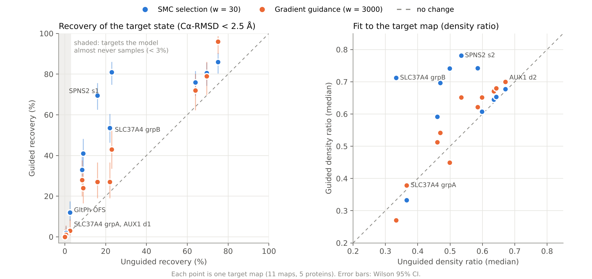

# Density-guided BioEmu

Inference-time steering of [BioEmu](https://github.com/microsoft/bioemu) with experimental cryo-EM density.

A differentiable cryo-EM density reward is plugged into BioEmu's steering module and used in two ways: particle selection (sequential Monte Carlo, SMC) and gradient guidance. The question is whether an experimental map can make a generative ensemble model sample the experimentally observed conformation more often, and under which conditions it cannot.

This is a follow-up to [generative-ensemble-cryoem-eval](https://github.com/qshang237/generative-ensemble-cryoem-eval), which benchmarked BioEmu, AlphaFlow and AF2 subsampling against the same cryo-EM maps. The same five proteins are used here, and the density ratio from that project is reported as a second, independent metric.

## Main findings

1. **Guidance amplifies, it does not create.** Where BioEmu already samples the target state, selection raises its frequency 1.2 to 4.8 fold. Where BioEmu essentially never samples it (SLC37A4 group A, AUX1 9ute), neither method helps; for the rarely sampled GltPh outward-facing state (2.5%), selection only multiplies the few existing hits and gradient guidance has no effect.
2. **Simple selection beats the gradient.** SMC selection costs almost nothing extra and gave the larger, more consistent gains. Gradient guidance costs about 2.7 times the unguided run and was significant on 5 of 11 targets.
3. **Two independent judges agree on selection.** Recovery by Cα-RMSD and the density ratio rise together and with the same target specificity, so the gain is not an artefact of optimising the reward.
4. **Gradient guidance refines locally.** It raises the fit to the map on almost every target, and with 100 samples it found a better best frame than the 335 to 490 frame unguided ensemble on 6 of 11 targets, but it rarely changes which state a structure is in.
5. **Guidance cannot separate states the map cannot separate.** For SPNS2 and GPR4 (states 0.7 to 1.1 Å apart) both maps raise both states. Same-state controls (GPR4, AUX1) gain no spurious new state.

In short: cryo-EM guidance does not produce better extreme conformations than BioEmu can, but it turns good conformations from a minority into a majority, provided the model samples them in the first place and the map can distinguish them.



*Each point is one target map (11 maps, 5 proteins). Left: fraction of structures within 2.5 Å Cα-RMSD of the target state, guided against unguided, Wilson 95% CI. Right: median density ratio against the target map. Points above the dashed line improved.*

## Results

Recovery = Cα-RMSD < 2.5 Å to the deposited model of the target state (pose on a state-invariant core). p values: Fisher's exact test against unguided. DR = density ratio, median over the ensemble against the target map. Unguided and selection: 200 structures; gradient: 100.

| Protein | Target (map / model) | Unguided | Selection (p) | Gradient (p) | DR unguided | DR selection | DR gradient |
|---|---|---|---|---|---|---|---|
| GltPh | outward, EMD-44530 / 9bh2 | 2.5% | 12.0% (3e-4) | 3.0% (1.00) | 0.46 | 0.59 | 0.51 |
| GltPh | intermediate, EMD-44529 / 9bh1 | 9.0% | 41.0% (7e-14) | 24.0% (7e-4) | 0.58 | 0.74 | 0.62 |
| GltPh | inward, EMD-21986 / 6x12 | 8.5% | 33.0% (1e-9) | 28.0% (2e-5) | 0.50 | 0.74 | 0.45 |
| SLC37A4 | group A, EMD-67847 / 21nq | 0.5% | 2.0% (0.37) | 1.0% (1.00) | 0.37 | 0.33 | 0.38 |
| SLC37A4 | group B, EMD-64144 / 9ugu | 22.0% | 53.5% (1e-10) | 27.0% (0.39) | 0.33 | 0.71 | 0.27 |
| SPNS2 | EMD-28651 / 8ex5 | 16.0% | 69.5% (3e-28) | 27.0% (0.03) | 0.47 | 0.70 | 0.54 |
| SPNS2 | EMD-28653 / 8ex7 | 23.0% | 81.0% (2e-32) | 43.0% (5e-4) | 0.53 | 0.78 | 0.65 |
| GPR4 | EMD-60057 / 8zfd | 69.5% | 80.5% (0.02) | 79.0% (0.10) | 0.60 | 0.61 | 0.65 |
| GPR4 | EMD-61839 / 9jvh | 64.0% | 76.0% (0.01) | 72.0% (0.19) | 0.63 | 0.64 | 0.67 |
| AUX1 | EMD-64490 / 9ute | 0% | 0% (1.00) | 0% (1.00) | 0.64 | 0.65 | 0.68 |
| AUX1 | EMD-61397 / 9jdr | 75.0% | 86.0% (8e-3) | 96.0% (2e-6) | 0.67 | 0.68 | 0.70 |

**Best single frame** (density ratio, as reported in the evaluation project) against gradient guidance:

| Target | Unguided BioEmu ensemble (335 to 490 frames) | Gradient guidance (100 frames) |
|---|---|---|
| GltPh intermediate (EMD-44529) | 0.853 | 0.871 |
| GltPh inward (EMD-21986) | 0.810 | 0.859 |
| SPNS2 (EMD-28651) | 0.805 | 0.841 |
| SPNS2 (EMD-28653) | 0.850 | 0.865 |
| GPR4 (EMD-60057) | 0.680 | 0.700 |
| GPR4 (EMD-61839) | 0.702 | 0.726 |

Additional checks, described in the project log:

* **Amplify or discover.** In SMC each batch of 10 particles is one group. Across all proteins the number of groups containing a hit is unchanged by selection (for example 16 to 17 of 20), while hits per successful group rise 2 to 4 fold: selection copies good structures, it does not find new ones.
* **Specificity.** On SLC37A4, aiming at group B raises B and leaves A at zero; aiming at group A cannot reach A but lowers B from 22% to 15%. On GltPh, selection aimed at one state raises that state's density ratio and lowers the other two.
* **Dose response (GltPh).** Gradient guidance has no effect at weights 30 and 300 and works from 1000 to 10000 without breaking structures beyond the unguided baseline.

## Method

* **Reward.** One Gaussian per Cα (σ = 0.225 × resolution, computed separably so it is exact and differentiable), masked Pearson CC against the map. The mask is fixed and derived from the map; the map is cropped to the protomer, binned to about 1.7 Å voxels and normalised.
* **Schedule.** The reward is evaluated on BioEmu's predicted clean structure and switched on smoothly after diffusion time t = 0.5.
* **Selection (SMC).** BioEmu `dpm_smc`, 10 particles, resampling when the effective sample size drops below half, weight 30.
* **Gradient guidance.** BioEmu `dpm_fkc` with the importance weights disabled, so only ∇CC is added to the score, weight 3000. The full FKC variant (gradient plus weights) was tested on GltPh at weight 30 and performed worse than selection alone.
* **Pose (oracle).** Each structure is placed in the map frame by Kabsch superposition of a state-invariant core onto the deposited model, with stop-gradient. This uses the deposited model and is an upper bound on what map-only placement could achieve.
* **Evaluation.** Primary: Cα-RMSD to every deposited model, recovery below 2.5 Å, Fisher's exact test, group-aware analysis of SMC groups. Secondary: the density ratio of the evaluation project, computed with its unchanged code (`density_ratio_steer.py` calls its `shared_fitting.py`). The reward never enters the primary metric.

## Limitations

* **Chain geometry.** BioEmu's stochastic sampler at noise 1.0 produces Cα chain breaks in almost all structures, guided and unguided alike (the original deterministic ensembles do not). Comparisons between conditions are fair, but the gradient-guidance density ratio gains should be confirmed at lower noise because breaks can let segments move into density.
* **Oracle pose.** Placement uses the deposited model (see Method). Map-only placement is not yet implemented.
* **Scale.** 100 to 200 structures per condition and one seed per condition outside GltPh.
* **No comparison yet** with other density-guided generators such as CryoBoltz.

## Repository layout

| Path | Contents |
|---|---|
| `density_potential.py` | Map I/O, preprocessing, Gaussian forward model, masked CC, Kabsch |
| `density_bioemu.py` | The BioEmu steering potential (`BioEmuDensityPotential`) |
| `proteins.py` | Sequences, chains, target maps and reference models for the five proteins |
| `prepare_targets.py` | Builds one target file per map (`targets/*.pt`) |
| `configs/` | Sampler configurations: unguided, selection, gradient only, full FKC |
| `run_condition.py` | Runs one sampling condition |
| `evaluate.py` | RMSD, recovery, CC, geometry, diversity, best-of-k |
| `density_ratio_steer.py` | Density ratio via the evaluation project's code |
| `submit_jobs.sh` | SLURM submission for all experiments |
| `figures/build_figure_data.py`, `figures/fig_scatter.py` | Collect per-target results into `results/figure_data.json`, then draw the main figure |
| `tests/` | Unit tests on synthetic data, and the real BioEmu sampling loop with a stand-in score model |
| `milestone1_checks.py`, `run_gltph_m1.py`, `synthetic.py` | First-stage checks of the reward on synthetic and real data |
| `results/` | Evaluation summaries and per-structure metrics |

## Usage

```bash
# environment: BioEmu >= 1.4 (with bioemu.steering), plus mdtraj, mrcfile, biopython, pytest
pip install "numpy<2"            # BioEmu's AlphaFold-based embedding step needs numpy 1.x
pytest -q tests/

# 1. target files (needs the evaluation project cloned alongside, with its emdb_maps/ and pdb_structures/)
python prepare_targets.py --root ../model-comparing --out targets --protein all

# 2. sample (one condition; see submit_jobs.sh for the full set)
python run_condition.py --condition smc_density --target targets/SLC37A4_grpB_9ugu.pt \
    --weight 30 --batch 10 --num_samples 200 --out runs/SLC37A4/grpB_9ugu/smc_density_w30

# 3. evaluate
python evaluate.py --protein SLC37A4 --target_state grpB_9ugu \
    --run unguided=runs/SLC37A4/base_fkc --run selection=runs/SLC37A4/grpB_9ugu/smc_density_w30 \
    --out results/SLC37A4/grpB_9ugu
python density_ratio_steer.py --mc_root ../model-comparing --runs runs --out results/density_ratio
python figures/build_figure_data.py --runs runs
python figures/fig_scatter.py
```

## Compute

All sampling ran on Queen Mary University of London's Apocrita HPC (NVIDIA A100, SLURM). 200 structures of a 422-residue protein take about 32 minutes unguided or with selection, and about 45 minutes per 100 structures with gradient guidance.

## Author

Qi Shang ([github.com/qshang237](https://github.com/qshang237)), PhD, Queen Mary University of London.
